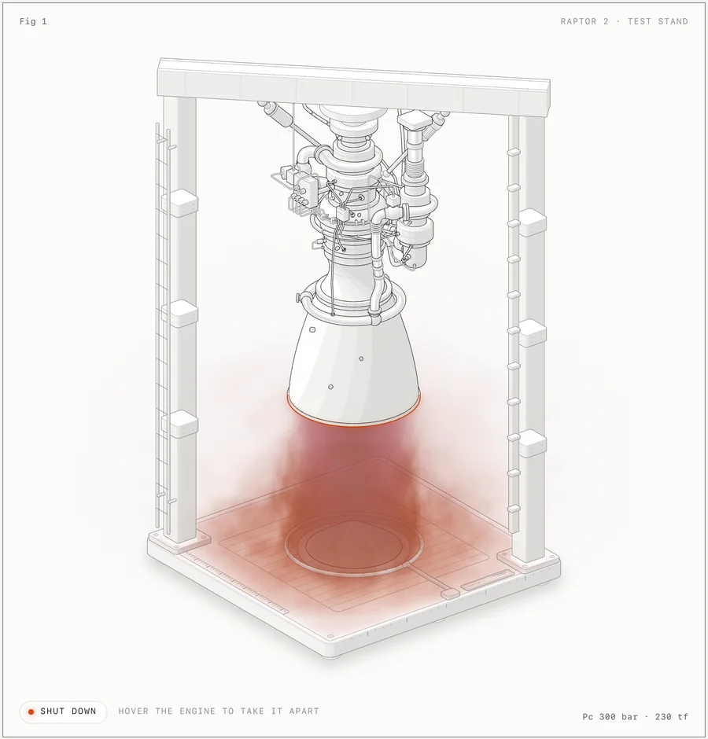
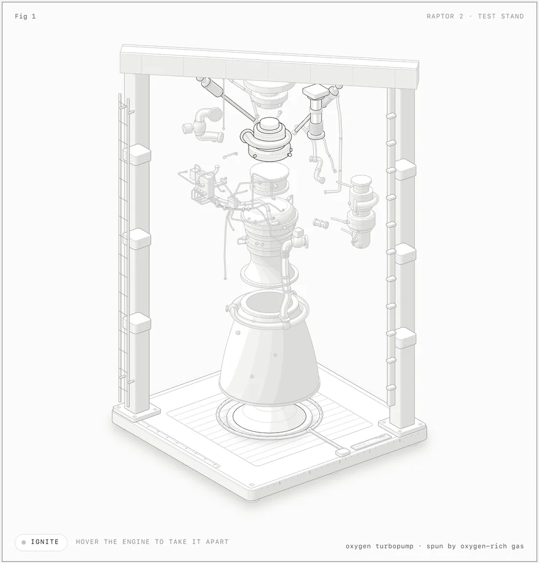
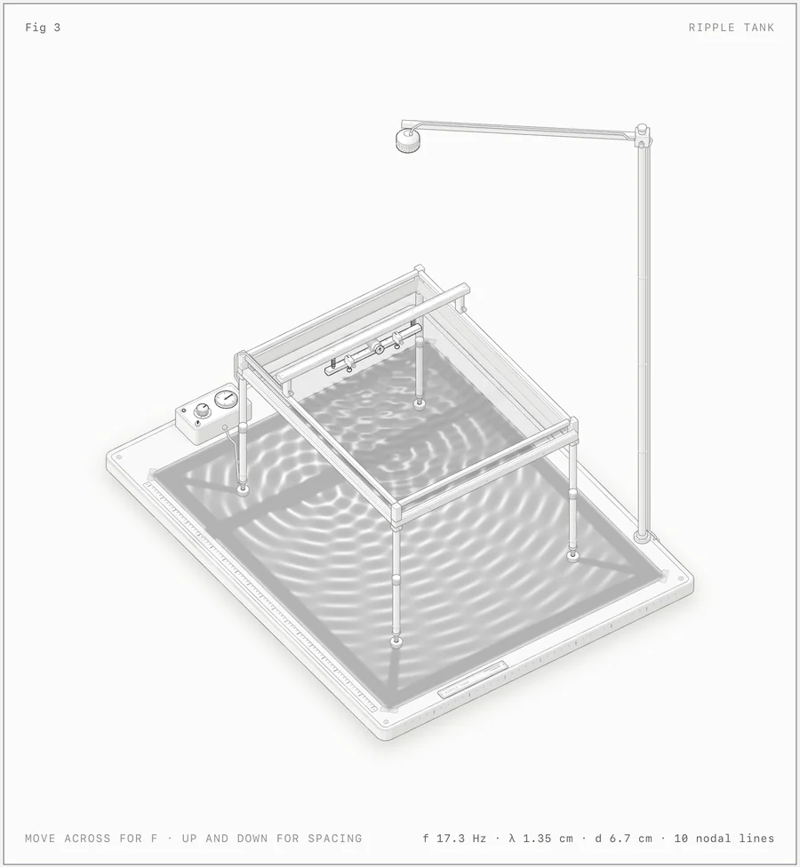
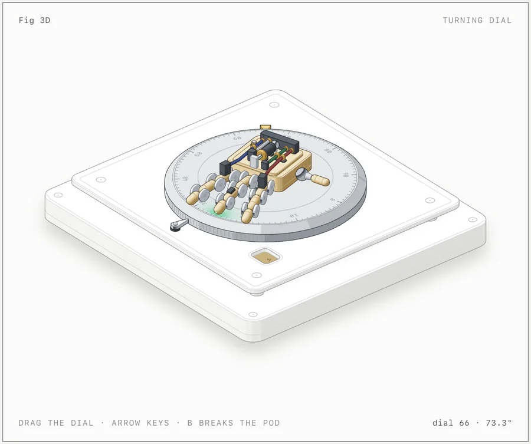
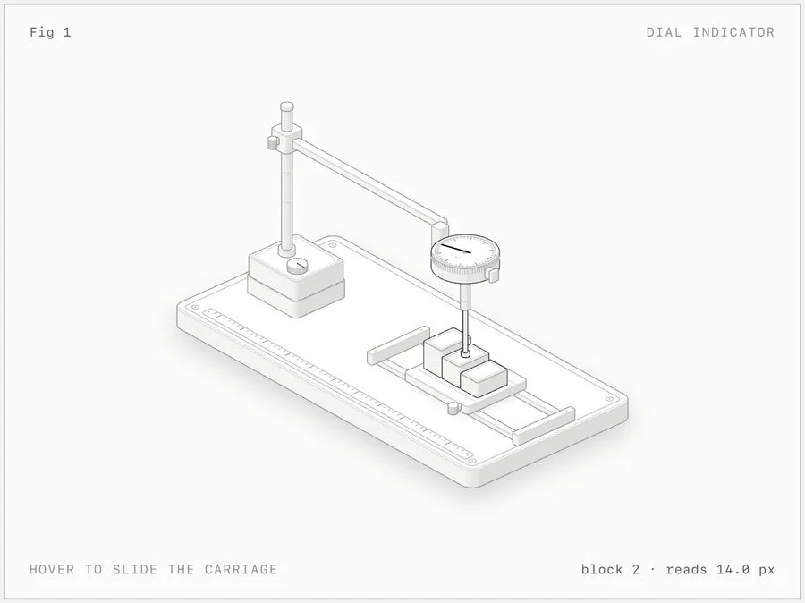

<h1 align="center">How It Works</h1>

<p align="center"><b>把一个概念造成一台真实的、可交互的等距机器来解释它。</b></p>

<p align="center">
  <a href="https://code.claude.com/docs/en/skills"></a>
  <a href="https://agentskills.io"></a>
  <a href="LICENSE"></a>
  <a href="#环境要求"></a>
  <a href="#环境要求"></a>
  <a href="https://github.com/steven0lisa/how-it-work-skill/actions/workflows/ci.yml"></a>
</p>

<p align="center">
  <a href="https://github.com/steven0lisa/how-it-work-skill/archive/refs/heads/main.zip"></a>
  &nbsp;
  <a href="#安装"></a>
</p>

<p align="center">
  <a href="#快速开始">快速开始</a> ·
  <a href="#图库">图库</a> ·
  <a href="#它能做出什么">它能做出什么</a> ·
  <a href="#安装">安装</a> ·
  <a href="#用法">用法</a> ·
  <a href="#示例">示例</a> ·
  <a href="#工作原理">工作原理</a> ·
  <a href="#限制">限制</a>
</p>

<p align="center">
  
</p>

<p align="center"><sub><code>examples/raptor-engine</code>，浅色主题，点火中。发动机与试车台是 SVG；尾焰是同一等距相机下的一段 WebGL 着色器。</sub></p>

---

让 Claude 画一张解释技术概念的图，How It Works 会让它发明一件实物——这件实物的运转方式*就是*概念本身。一个「没有变化就跳过工作」的缓存键（cache key），会变成一把只有每颗弹子都对齐才肯转动的弹子锁（pin-tumbler lock）；一个为多块画布服务的 GPU 上下文，会变成一台龙门式绘图机（gantry plotter），它唯一的打印头依次访问 16 个孔位。

随后，Claude 用几十个小巧、实体、带明暗着色的零件把它造出来，装进一张带边框的卡片——有标题、有操作提示、有实时读数——让它在指针与键盘的驱动下从容运动，并放大每一处接合来自查工作。图中显示的每一个数字，都来自驱动其零件运动的同一个小模型。

## 快速开始

```sh
npx skills add steven0lisa/how-it-work-skill -g
```

CLI 会询问要为哪些 agent 安装（Claude Code、Antigravity、OpenCode、Codex、MiniMax Code）。想跳过提问，加上 `-a claude-code`、`-a antigravity`、`-a opencode`、`-a codex` 或 `-a minimax-code` 即可。

然后，在 Claude Code 里：

```text
/how-it-work explain how a token bucket rate limiter works, interactive
```

若要用于 Antigravity、OpenCode、Codex 或 MiniMax Code，指定对应 agent：`-a antigravity`、`-a opencode`、`-a codex` 或 `-a minimax-code`。Antigravity、OpenCode 与 MiniMax Code 使用同样的 `/how-it-work` 命令；在 Codex 里输入 `$how-it-work`。

就这样。无需 API 密钥，也无需 `npm install`：这套工具包只用 Node 内置模块。

## 图库

<table>
  <tr>
    <td width="50%"></td>
    <td width="50%"></td>
  </tr>
  <tr>
    <td><sub><b>raptor-engine</b>：悬停即可分解为 11 个组件。审计证明没有任何管道穿过任何东西——静止时、分解时以及其间每一帧都如此。</sub></td>
    <td><sub><b>ripple-tank</b>：SVG 装置叠加两层 WebGL（灯光照明与纸屏上的焦散、水面里的倒影），由一个色散与光学模型驱动。</sub></td>
  </tr>
  <tr>
    <td></td>
    <td></td>
  </tr>
  <tr>
    <td><sub><b>turning-dial</b>：3D 模式（beta）。拖动转盘时，约 90 个零件每帧重新投影、重新着色。</sub></td>
    <td><sub><b>dial-indicator</b>：最小的示例，约 300 行。悬停滑动滑座；指针逐块读数。</sub></td>
  </tr>
</table>

所有截图都是 [`examples/`](examples) 中某个页面的浅色主题，由技能自带的 [`scripts/capture.mjs`](scripts/capture.mjs) 与 [`scripts/drive.mjs`](scripts/drive.mjs) 截取。构建好的页面已提交入库：打开 `examples/` 里任意 `.html` 即可试用。

## 它能做出什么

三种图。三者共用同一套工具包、同一个相机与同一套工艺规则。

| 类型 | 是什么 | 示例 |
|---|---|---|
| **SVG** | 核心。实体的等距零件配四阶明暗着色，按由后到前的顺序绘制，装在有实时读数与缓动动画的卡片里。可交付为独立 HTML 页面、内嵌样式的单个 `.svg` 文件，或 React/Next.js 组件。 | `dial-indicator`、`desk-computer`、`arcade-cabinet`、`test-rig` |
| **SVG + WebGL** | 用于线条画不出的东西：火、尾焰、水、焦散、灯光、辉光、蒸汽。着色器运行在前后两层 SVG 之间的画布上，处于图自己的等距相机里，因此融在画面之内。没有 WebGL 时 SVG 依然可读。 | `raptor-engine`、`ripple-tank` |
| **3D** <sup>beta</sup> | 在真 3D 中转动的零件：会旋转的表盘或转台、会弯屈的手指、会断裂坠落的部件。运动零件每帧都按工具包自己的规则重新投影、重新着色；图的其余部分保持静态画面。 | `turning-dial` |

每张图都有浅色与深色两版。浅色是技能优先设计的主题，着色器也不例外。

## 安装

How It Works 是一个标准的 [Agent Skill](https://agentskills.io)：一个根目录带 `SKILL.md` 的文件夹。本仓库就是这个文件夹。任选一种方式安装：

| | 命令 | 安装到 |
|---|---|---|
| **skills CLI**，装给你自己（Claude Code） | `npx skills add steven0lisa/how-it-work-skill -g -a claude-code` | `~/.claude/skills/how-it-work` |
| **skills CLI**，装给你自己（Antigravity） | `npx skills add steven0lisa/how-it-work-skill -g -a antigravity` | `~/.gemini/antigravity/skills/how-it-work` |
| **skills CLI**，装给你自己（OpenCode） | `npx skills add steven0lisa/how-it-work-skill -g -a opencode` | `~/.config/opencode/skills/how-it-work` |
| **skills CLI**，装给你自己（Codex） | `npx skills add steven0lisa/how-it-work-skill -g -a codex` | `~/.agents/skills/how-it-work` |
| **skills CLI**，装给你自己（MiniMax Code） | `npx skills add steven0lisa/how-it-work-skill -g -a minimax-code` | `~/.minimax/skills/how-it-work` |
| **skills CLI**，装进单个项目 | `npx skills add steven0lisa/how-it-work-skill` | Claude Code 为 `.claude/skills/how-it-work`；Antigravity、OpenCode 与 Codex 为 `.agents/skills/how-it-work`；MiniMax Code 为 `.minimax/skills/how-it-work` |
| **git**，装给你自己（Claude Code） | `git clone https://github.com/steven0lisa/how-it-work-skill.git ~/.claude/skills/how-it-work` | `~/.claude/skills/how-it-work` |
| **git**，装给你自己（Antigravity） | `git clone https://github.com/steven0lisa/how-it-work-skill.git ~/.gemini/antigravity/skills/how-it-work` | `~/.gemini/antigravity/skills/how-it-work` |
| **git**，装给你自己（OpenCode） | `git clone https://github.com/steven0lisa/how-it-work-skill.git ~/.config/opencode/skills/how-it-work` | `~/.config/opencode/skills/how-it-work` |
| **git**，装给你自己（Codex） | `git clone https://github.com/steven0lisa/how-it-work-skill.git ~/.agents/skills/how-it-work` | `~/.agents/skills/how-it-work` |
| **git**，装给你自己（MiniMax Code） | `git clone https://github.com/steven0lisa/how-it-work-skill.git ~/.minimax/skills/how-it-work` | `~/.minimax/skills/how-it-work` |
| **git**，装进单个项目 | `git clone https://github.com/steven0lisa/how-it-work-skill.git .claude/skills/how-it-work` | Claude Code 与 OpenCode 为 `.claude/skills/how-it-work`；Antigravity、OpenCode、Codex 与 MiniMax Code 为 `.agents/skills/how-it-work` |
| **下载**，不用 git | 见下文 | 上述任意文件夹 |

<details>
<summary><b>使用 skills CLI</b></summary>

<br>

[`skills`](https://github.com/vercel-labs/skills) CLI 会找到本仓库根目录的 `SKILL.md` 并将其安装为 `how-it-work`。默认安装到当前项目，并询问要为哪些 agent 安装。`-g` 为你的用户全局安装；`-a claude-code` 只配置 Claude Code。只用 Antigravity、OpenCode、Codex 或 MiniMax Code 时，分别用 `-a antigravity`、`-a opencode`、`-a codex` 或 `-a minimax-code`。

CLI 会复制整个仓库，示例也一并带上（约 10 MB）。它需要较新的 Node.js：CLI 的 1.7.1 版要求 22.20 或更高。

</details>

<details>
<summary><b>使用 git</b></summary>

<br>

把仓库克隆到某个技能文件夹之下，让 `SKILL.md` 最终位于 `<技能文件夹>/how-it-work/SKILL.md`。Claude Code 用 `~/.claude/skills/how-it-work` 或 `.claude/skills/how-it-work`。Antigravity 用 `~/.gemini/antigravity/skills/how-it-work` 或 `.agents/skills/how-it-work`。OpenCode 用 `~/.config/opencode/skills/how-it-work` 或 `.opencode/skills/how-it-work`；OpenCode 也会读取 Claude Code 与 `.agents` 文件夹。Codex 用 `~/.agents/skills/how-it-work` 或 `.agents/skills/how-it-work`。MiniMax Code 用 `~/.minimax/skills/how-it-work`（若移动过其数据文件夹，则是 `$MINIMAX_DATA_DIR/skills/how-it-work`）或 `.minimax/skills/how-it-work`；MiniMax Code 也会读取 Claude Code、Codex 与 `.agents` 文件夹。项目级安装请把该文件夹提交入库，让团队也能拿到。以后更新时，在该文件夹里执行 `git pull`。

</details>

<details>
<summary><b>下载，不用 git</b></summary>

<br>

[下载 ZIP](https://github.com/steven0lisa/how-it-work-skill/archive/refs/heads/main.zip)，解压，把文件夹从 `how-it-work-skill-main` 改名为 `how-it-work`，再移入 `~/.claude/skills/`（Claude Code）、`~/.gemini/antigravity/skills/`（Antigravity）、`~/.config/opencode/skills/`（OpenCode）、`~/.agents/skills/`（Codex）或 `~/.minimax/skills/`（MiniMax Code）。

或在 macOS / Linux 上一行完成：

```sh
mkdir -p ~/.claude/skills/how-it-work && curl -L https://github.com/steven0lisa/how-it-work-skill/archive/refs/heads/main.tar.gz | tar -xz --strip-components=1 -C ~/.claude/skills/how-it-work
```

若用于 Antigravity、OpenCode、Codex 或 MiniMax Code，把同样的文件放进 `~/.gemini/antigravity/skills/how-it-work`、`~/.config/opencode/skills/how-it-work`、`~/.agents/skills/how-it-work` 或 `~/.minimax/skills/how-it-work`：

```sh
mkdir -p ~/.gemini/antigravity/skills/how-it-work && curl -L https://github.com/steven0lisa/how-it-work-skill/archive/refs/heads/main.tar.gz | tar -xz --strip-components=1 -C ~/.gemini/antigravity/skills/how-it-work
```

```sh
mkdir -p ~/.config/opencode/skills/how-it-work && curl -L https://github.com/steven0lisa/how-it-work-skill/archive/refs/heads/main.tar.gz | tar -xz --strip-components=1 -C ~/.config/opencode/skills/how-it-work
```

</details>

Claude Code 能在运行中的会话里加载新技能。若会话启动时 `skills` 文件夹本身还不存在，请运行 `/reload-skills`。Antigravity 与 OpenCode 在聊天里把它列为 `/how-it-work`；没显示就重启。Codex 在 `/skills` 下列出它，用 `$how-it-work` 运行；没显示就重启 Codex。MiniMax Code 把它列为 `/how-it-work`；没显示就重启 `mcode`。

<details>
<summary><b>Codex：浏览器检查被拦时</b></summary>

<br>

技能通过启动无头 Chrome 来自查图作：Chrome 会写入一个临时 profile，并经本地端口与其通信。Codex 在沙箱里运行命令，沙箱可能拦下 Chrome。图仍然会构建完成；只是检查失败。按优先顺序：

1. 当 Codex 请求在沙箱外运行某次检查时，为该命令放行。这需要默认的 `approval_policy = "on-request"`。
2. 或在 `~/.codex/config.toml` 里放行一次：

   ```toml
   approval_policy = "on-request"
   sandbox_mode = "workspace-write"

   [sandbox_workspace_write]
   network_access = true
   writable_roots = ["/tmp"]
   ```

   较新的 Codex 版本可能给这些设置换了名字；请查你这版对应的配置参考。
3. 或在普通终端里自己运行检查，例如 `node scripts/capture.mjs page.html --out shots/page.png`。

用 `--sandbox danger-full-access` 启动 Codex 也可行，但它会解除该会话的一切限制，只对你信任的项目使用。

</details>

## 用法

输入 `/how-it-work`（Codex 里是 `$how-it-work`），说明这张图要解释什么：

```text
/how-it-work explain how a token bucket rate limiter works, interactive
```

你不必点名这个技能。当你想要一张等距插画、给文档/博客文章/落地页配的解释图，或一个交互式讲解时，Claude 也会加载它。Antigravity、OpenCode、Codex 与 MiniMax Code 同样如此。

<details>
<summary><b>更多提示词</b>，来自技能的 <a href="evals/evals.json">评测集</a></summary>

<br>

```text
/how-it-work a figure for our Next.js docs on database connection pooling: a pool of 10 connections, requests borrow one and give it back, and when all 10 are busy new requests wait in a queue. A React component plus a static HTML preview, dark theme.
```

```text
/how-it-work an isometric SVG explaining how a CDN edge cache works, cache hit vs miss, TTL of 60 s, for a dark landing page. Just the SVG file and a PNG preview.
```

```text
/how-it-work a Bunsen burner on a lab bench: opening the air collar turns the lazy yellow flame into a roaring blue cone. WebGL for the flame, one HTML file, dark theme.
```

```text
/how-it-work a heat-exchanger espresso machine with the side panel off: boiler, heat-exchanger tube, group head, pump, steam wand and gauge. Show the water flowing when you pull a shot. Standalone HTML, light theme.
```

</details>

三个习惯能换来最好的图：

1. **说想法，别说画法。**说明它该解释什么，并给出真实数字（尺寸、数量、速率、阈值）。实物由 How It Works 来发明——这占了大半工作量，而且它做得比一份「方框加箭头」的描述更好。
2. **或者直接点名实物。**如果你已经想好要哪台机器（一台意式咖啡机、一支本生灯、一把锁），就说出来，并说明哪里应该动。
3. **说明它将住在哪里。**独立 HTML 页面、单个 SVG 文件，还是 React/Next.js 组件；浅色还是深色。构建产物因之而异。

每张图都以你拥有的源码交付：一个 Node 构建脚本和它写出的页面；React 则是几何模块、一个承载静态画面的服务端组件，再加一个负责运动的客户端组件。工具包随附其中。

## 示例

每个无框架示例都带一个 Node 构建脚本，在自身旁边写出独立页面。加 `--light` 得到浅色主题。

| 示例 | 展示内容 | 构建 |
|---|---|---|
| [`dial-indicator`](examples/dial-indicator) | 支架上的一只量表，下方是量块滑座。最小的示例，约 300 行。 | `node examples/dial-indicator/build.mjs` |
| [`desk-computer`](examples/desk-computer) | 一台 1984 年风格的桌面电脑，键盘可以真的打字。键入的行出现在与机箱正面同一平面上的 CRT 里；关机时画面塌缩成一条线和一个点。约 85 个实体。 | `node examples/desk-computer/build.mjs` |
| [`arcade-cabinet`](examples/arcade-cabinet) | 一台侧板已拆的立式街机。投进一枚 25 美分硬币：它沿投币滑道滚过投币开关的触线落进钱箱，一个脉冲沿缆线跑到主板，CRT 预热进入演示模式，画面画在与倾斜显示器同一平面上。约 240 个实体、15 根缆线。 | `node examples/arcade-cabinet/build.mjs` |
| [`raptor-engine`](examples/raptor-engine) | 试车台上的一台 Raptor 2 发动机。可分解为 11 个组件；WebGL 渲染的尾焰、激波、溅射与蒸汽绘制在前后两层 SVG 之间。密集管路、平滑着色、淡入淡出与审计的参考实现。构建需几分钟。 | `node examples/raptor-engine/build.mjs` |
| [`ripple-tank`](examples/ripple-tank) | 架在高腿上的教学水波槽，下方是纸屏，视角自上方 44°。两层 WebGL 对齐到等距平面，由 `model.mjs` 里的纯模型驱动。 | `node examples/ripple-tank/build.mjs` |
| [`test-rig`](examples/test-rig) | 来自 React/Next.js 站点的一张生产图作：弹簧滑座上的一枚玻璃按钮、导轨上的一根手指探针，以及读出倾斜量的量表。53 个实体。无构建脚本：直接复制进 React 应用。 | 无 |
| [`spot-plate`](examples/spot-plate) | 同一站点的另一张图：点滴板上的六对玻璃液滴，随着一扇量隙片张开而汇成一片玻璃。每对液滴都由同一个距离场画出。无构建脚本：直接复制进 React 应用。 | 无 |
| [`turning-dial`](examples/turning-dial) | 3D 模式：在真 3D 中转动的密码转盘，上面伏着一只小机械手；一根三铰链手指会抬起；一个部件会脱落成为自由体。`stress.mjs` 是杂乱车间里一只 380 零件的机械手，用于测量性能。 | `node examples/turning-dial/build.mjs` |

Raptor 与街机还能打印。`node scripts/print.mjs examples/raptor-engine/sheet.mjs --format all` 会从构建好的浅色页面写出三份 A4 PDF：一页海报、一页技术图纸和一份两页详解。对任何一张图要求可打印版本，How It Works 都会写出它的 `sheet.mjs`；见 [`references/print.md`](references/print.md)。

`node examples/raptor-engine/build.mjs --audit`、`node examples/arcade-cabinet/build.mjs --audit` 与 `node examples/turning-dial/build.mjs --light --audit` 还会运行几何审计。3D 审计较慢；见 [`references/3d.md`](references/3d.md)。

## 工作原理

- **[`SKILL.md`](SKILL.md)** 是 Claude 读到的内容。它规定了工作流：先收集真实数字，发明实物，写零件清单，规划世界，用工具包一次性构建几何体，由后向前着色，装框，赋予生命，然后像批评家一样验证。工艺规则也以简短形式收在其中。
- **[`kit/`](kit)** 是构建图作所用的绘图库：等距相机、实体与零件库（`iso-kit`）、任意轴上的回转体零件（`lathe.mjs`）、管道与缆线（`tube.mjs`）、WebGL 层（`gl.mjs`）、3D 运行时（`turn*.mjs`），以及 React 组件（`react/`）。除这些组件所依赖的 React 外，没有任何依赖。
- **[`references/`](references)** 是 Claude 需要时才打开的长文指南：工艺、工具包 API、运动、React、验证、WebGL、一次设计全程走查，以及 3D 模式。
- **验证。**[`kit/audit.mjs`](kit/audit.mjs) 证明几何：没有任何东西穿过任何东西，每个端点都落在安装座上，每处重叠都按深度顺序绘制（`node build.mjs --audit`）。在无头 Chrome 里，[`scripts/capture.mjs`](scripts/capture.mjs) 与 [`scripts/drive.mjs`](scripts/drive.mjs) 截取整图、特写与慢放连拍；[`scripts/lines.mjs`](scripts/lines.mjs) 会把任何悬空断线判为失败；[`scripts/turn-check.mjs`](scripts/turn-check.mjs) 检查 3D 图作。技能要求 Claude 逐张读自己生成的每个 PNG。

<details>
<summary><b>仓库结构</b></summary>

<br>

```text
how-it-work/
├── SKILL.md                  the skill: workflow, setup and craft rules
├── kit/                      the drawing library
│   ├── iso-kit.ts            the core: camera, solids, parts, SVG renderer, card and page, CSS
│   ├── iso-kit.mjs           the same core as plain ESM, for Node build scripts
│   ├── iso.css               the kit's CSS, both themes
│   ├── react/                draw.tsx (server-safe components), live.tsx (client hooks)
│   ├── lathe.mjs             round parts on any axis
│   ├── tube.mjs              pipes, tubes and cables
│   ├── audit.mjs             the geometry audit
│   ├── gl.mjs                the WebGL layer for shaders inside the drawing
│   ├── turn.mjs              the 3D runtime (beta)
│   ├── turn-build.mjs        the 3D builder
│   ├── turn-audit.mjs        the 3D orbit audit
│   └── turn-fixed.mjs, canvas-painter.mjs, gl-shared.mjs
│                             experimental variants, not yet documented or used by the examples
├── references/               long-form guides Claude reads as needed
│   ├── craft.md  kit.md  motion.md  react.md
│   └── verify.md  webgl.md  walkthrough.md  3d.md
├── scripts/                  headless Chrome checks and build helpers
│   ├── capture.mjs           screenshots and close-ups
│   ├── drive.mjs             scripted sessions and contact sheets
│   ├── lines.mjs             the line-end check (with line-ends.mjs)
│   ├── inline-kit.mjs        the kit as source, to inline into a standalone page
│   ├── turn-check.mjs        3D checks in the browser (with turn-fidelity.mjs)
│   └── turn-bench.mjs        3D timing in Node
├── examples/                 eight complete figures, built pages committed
├── evals/evals.json          test prompts and what a good answer contains
└── .github/                  issue forms, PR template, CI, README images
```

</details>

## 环境要求

| | 用于 | 说明 |
|---|---|---|
| **[Claude Code](https://code.claude.com/docs/en/overview)**，或 [Antigravity](https://antigravity.google)、[OpenCode](https://opencode.ai/docs/skills/)、[Codex](https://developers.openai.com/codex/skills)、[MiniMax Code](https://github.com/MiniMax-AI/minimax-code) | 全部 | 技能为 Claude Code 编写，遵循开放的 Agent Skills 格式，因此 Antigravity、OpenCode、Codex 与 MiniMax Code 也能加载它。在 Codex 中，浏览器检查会启动 Chrome；若其沙箱拦截，为这些命令放行即可。 |
| **Node.js 20.10+** | 构建、工具包、检查 | 只用内置模块：无需 `npm install`。示例已在 Node 20.19 与 22.11 上逐字节重建验证。Node 20 下浏览器脚本会带 `--experimental-websocket` 自行重启。 |
| **Chrome 或 Chromium** | 各项检查 | `capture.mjs`、`drive.mjs`、`lines.mjs` 与 `turn-check.mjs` 会在 macOS、Linux、Windows 的常规位置及 Playwright 缓存中查找。其他二进制请设置 `CHROME_PATH`。它们以无头模式并开启 WebGL 运行 Chrome。 |
| **React 18+** | 仅 React 输出 | `kit/react/`、`examples/test-rig/` 与 `examples/spot-plate/`。 |

## 限制

- **它不是图表库。**没有坐标轴、数据系列或数据图。数字以模型驱动的实时读数出现，也以零件的真实尺寸与数量出现。
- **它画机器、仪器、工具与家具。**不画人物，也不画精确地图。没有可构建机构的概念，成品会偏弱。
- **它慢得有意为之。**一张图需要一段长会话：零件清单、几何、审计，以及两套主题下每个接合处的特写。Raptor 的构建需几分钟；30 个零件的完整 3D 环视审计需 15 到 20 分钟。
- **着色器需要 WebGL。**没有它 SVG 依然可读；在「减少动态效果」设置下，每张图都会静止。

> [!NOTE]
> **3D 模式为 beta。**它只在自家示例和一个测试图上得到验证，尚未在生产图上验证。小的 3D 图能跑 60 fps；380 零件的应力机械手在一台高负载机器上实测约 20 fps（1440 px 宽），节流手机 profile 下 13 到 15 fps。

## 分享图作

做出好东西了？让 agent *「把这张图发布到 How It Works 社区图库」*。它会要一个标题和你的 GitHub 用户名，展示将要提交的内容，经你确认后替你在 [anatomy-community](https://github.com/wheresryan22/anatomy-community) 上开一个 pull request：无需 git，无需手动 fork。也可以自己运行 `scripts/publish.mjs --submit`。没有终端时，用图库的 **Submit a figure** 表单配合 GitHub Gist 提交。

## 参与贡献

欢迎 issue 与 pull request。先读 [CONTRIBUTING.md](CONTRIBUTING.md)：其中涵盖示例构建、各项检查，以及改动必须守住的内部规则（其中包括：代码中不写注释；工具包改动必须让所有现有示例逐字节不变）。请遵守[行为准则](CODE_OF_CONDUCT.md)，安全问题按 [SECURITY.md](SECURITY.md) 所述上报。

- [报告 bug](https://github.com/steven0lisa/how-it-work-skill/issues/new?template=bug_report.yml)
- [请求一张图](https://github.com/steven0lisa/how-it-work-skill/issues/new?template=figure_request.yml)
- [更新日志](CHANGELOG.md)

## 许可证

[MIT](LICENSE) © 2026 Ryan · [@wheresryan22](https://x.com/wheresryan22)

<p align="center"><sub>如果 How It Works 为你画出了有用的东西，一个 ⭐ 能帮更多人找到它。</sub></p>

## 致谢

本项目基于 [wheresryan22/anatomy](https://github.com/wheresryan22/anatomy)（MIT 协议）中文化并更名为 how-it-work。原始设计与工艺规则来自原作者；翻译与改名维护：[steven0lisa](https://github.com/steven0lisa)。
